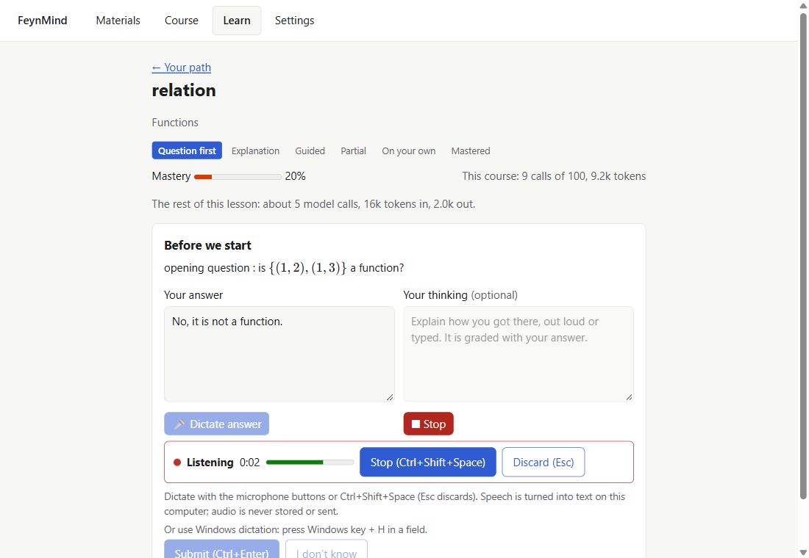
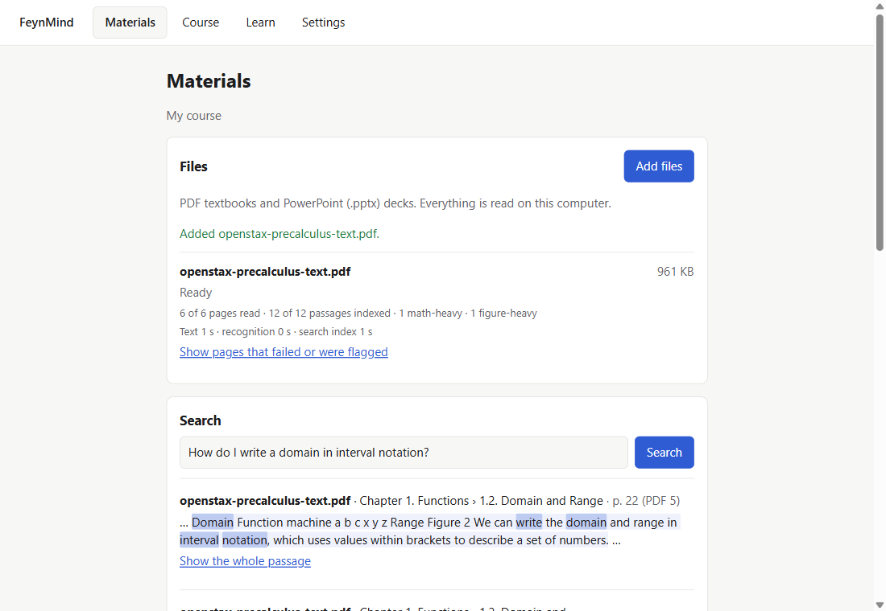
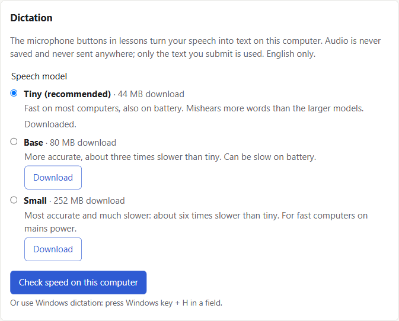
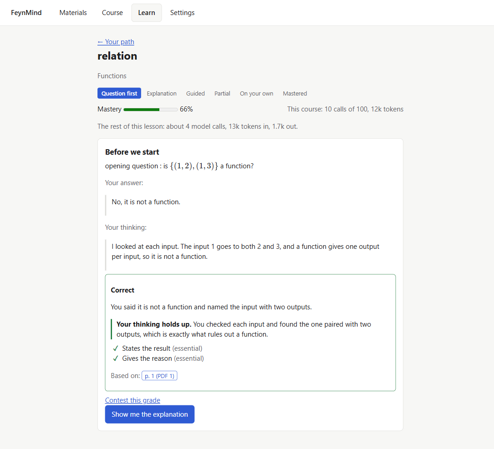

# FeynMind

FeynMind turns a course's own textbooks, slide decks and syllabus into a personal tutor on your computer. It works out what you already know, teaches what you don't with questions grounded in your materials (citing the pages), grades your answers and your reasoning, and tracks what you have mastered. You can explain your thinking out loud: speech becomes text on your own machine.

It is free and open source (MIT). There is no account and no server: your files and progress stay on your computer, and you bring your own AI provider key.

> **Early preview (0.1.0).** This is the first public build. It is usable for one course end to end, but it is unfinished, has rough edges, and its data format may change between versions. Please report problems in [Issues](https://github.com/dsdsouza/FeynMind/issues).



## What works today

- **Your materials, read locally.** Import PDF textbooks (including scanned pages, which are read with on-device text recognition) and PowerPoint (.pptx) decks. Search them by meaning and by wording; results open on the matching sentences with their printed page numbers.
- **Syllabus and concepts.** Import your syllabus (PDF or pasted text) and match its units to the book's sections. Process one unit at a time: FeynMind shows an estimate of the model calls and tokens first, then reads math-heavy and figure-heavy pages with a vision model and extracts the unit's concepts and their prerequisites. A review screen lets you rename, merge, delete and relink concepts.
- **Diagnostic.** A short multiple-choice quiz marks each unit as known, shaky or new; you can correct it with a quick check.
- **Lessons.** Each concept starts with a question, then an explanation with a worked example that cites your book's pages, then practice that fades support (guided, partial, on your own). Answers are graded against a rubric with a visible reason for every decision, and you can contest a grade once.
- **Your thinking, typed or spoken.** Beside every answer is an optional "Your thinking" field. Type it, or press the microphone (or Ctrl+Shift+Space) and speak; the text appears in the field for you to edit. The grader judges the reasoning too, and a right answer reached by faulty reasoning does not count as mastered. Windows and macOS dictation work as well.
- **Mastery tracking.** A mastery estimate per concept, updated after every answer; a concept unlocks when its prerequisites are mastered.
- **Cost control.** Every model call is estimated before a job, cached so no page is paid for twice, rate limited, and counted against a call cap you set (with a dollar figure when the model's price is known).
- **Crash safe.** An interrupted import, unit or lesson resumes where it stopped; answers are saved before they are graded.



## Known limitations

- **Gemini only.** The only supported AI provider is Google Gemini, and one model does every job. Claude, ChatGPT, Qwen and Grok, and choosing a model per role, are planned.
- **English only.** Search, text recognition of scanned pages, and dictation are English-only.
- **No spaced reviews yet.** Concepts are taught and mastered, but reviews scheduled for when you are about to forget them are not built yet.
- **One course at a time.** Goal-based pathways, multiple courses and the learning map are planned.
- **Apple silicon Macs only.** The macOS build runs on M1 and later; Intel Macs are not supported.
- **Unsigned installers.** The installers are not signed with paid certificates, so Windows and macOS warn before the first launch (see below).
- **Install steps for macOS and Linux are untested.** They have not yet been tried on those systems; please open an issue if one is wrong.
- **Key storage on Linux without a keyring is unverified.** FeynMind is meant to refuse to save your API key when no secure storage is available, but this has not been checked on a Linux system without a keyring. Install and unlock a keyring (such as GNOME Keyring or KWallet) before saving your key.
- **Preview quality.** Grading has been checked on a small benchmark (32 cases), not at scale; the vision model can misread small details on a page; spoken math has not been tested; only .pptx (not .ppt) slide decks are read.

## Install

Download the installer for your system from the [Releases page](https://github.com/dsdsouza/FeynMind/releases).

### Windows (64-bit)

1. Run `FeynMind-<version>-win-x64.exe`.
2. Windows SmartScreen may say "Windows protected your PC", because the installer is not signed. Click **More info**, then **Run anyway**.
3. Follow the installer.

### macOS (Apple silicon)

> **Not yet tested on a Mac.** These steps have not been tried on macOS by the project yet. If a step is wrong or missing, please [open an issue](https://github.com/dsdsouza/FeynMind/issues).

1. Open `FeynMind-<version>-mac-arm64.dmg` and drag FeynMind to Applications.
2. Open FeynMind. macOS will refuse the first time, because the app is not signed by an identified developer.
   - On macOS 15 (Sequoia) and later: open **System Settings › Privacy & Security**, scroll down to the message about FeynMind, click **Open Anyway** and confirm.
   - On earlier versions: Control-click FeynMind in Applications, choose **Open**, then **Open** again.
3. If macOS says FeynMind "is damaged and can't be opened", that is the same missing signature. Run this in Terminal, then open it again:

   ```sh
   xattr -dr com.apple.quarantine /Applications/FeynMind.app
   ```

4. The first time you dictate, macOS asks for microphone access. Because the build is unsigned, it may ask again after you update FeynMind.

### Linux (x86-64)

> **Not yet tested on a Linux desktop.** These steps have not been tried on a Linux desktop by the project yet. If a step is wrong or missing, please [open an issue](https://github.com/dsdsouza/FeynMind/issues).

1. Download the `.AppImage` file, make it executable and run it:

   ```sh
   chmod +x FeynMind-*.AppImage
   ./FeynMind-*.AppImage
   ```

2. AppImages need FUSE 2. If it does not start, install it: `sudo apt install libfuse2` on Ubuntu 22.04, or `sudo apt install libfuse2t64` on Ubuntu 24.04 and later.
3. If it exits with a message about the sandbox (Ubuntu 23.10 and later restrict the browser sandbox that apps like this use), you can start it with `--no-sandbox`. That turns off a layer of protection between the app's window and your system, so only do it if you accept that.

### Get a Gemini API key

1. Sign in at [Google AI Studio](https://aistudio.google.com/apikey) and create an API key.
2. In FeynMind, open **Settings**, paste the key, choose a model (a "flash-lite" model is cheapest) and press **Test**.

The key is encrypted with your system's secure storage (Windows data protection, the macOS Keychain, or a Linux keyring such as GNOME Keyring or KWallet) and is sent only to Google. On Linux without an unlocked keyring, FeynMind does not save the key. Gemini has a free tier with daily limits; on the free tier, Google may use what you send to improve its products. Set a call cap per course in **Settings › Usage limits**.

### Choose a speech model (optional)

The first time you press a microphone button, FeynMind offers to download its speech model (Tiny, 44 MB). **Settings › Dictation** offers larger, more accurate models and a "Check speed on this computer" button that times a half-minute clip. Tiny suits most computers, including laptops on battery; typing and your system's own dictation always work too.



## Privacy

FeynMind has no account, no server of its own and no telemetry.

**Stays on your computer:** your imported files (copied into FeynMind's data folder), the text read from them, the search index, your answers, reasoning, grades and progress, the models it downloads, and a crash log. Audio from the microphone is turned into text on your computer, held in memory only, and never stored or sent anywhere.

**Leaves your computer, only to Google's Gemini API, using your key, and only when you start the step:**

- When you import a syllabus: its text.
- When you process a unit (after you approve its estimate): the text of that unit's sections, and images of its math-heavy and figure-heavy pages.
- During the diagnostic and lessons: passages from your materials about the concept, the questions, your answers and your typed or dictated reasoning (as text), and any objection to a grade.

Before the first request that sends course material, FeynMind shows a notice naming the provider and asks you to confirm.

**Downloads:** on first use, FeynMind downloads its local search model (about 35 MB) and, when you first dictate, a speech model (44 MB by default) from Hugging Face. Each is pinned to a fixed version and checked against a checksum. Nothing else is downloaded.

**Where your data lives:** `%APPDATA%\FeynMind` on Windows, `~/Library/Application Support/FeynMind` on macOS, and `~/.config/FeynMind` on Linux. Delete that folder to remove everything.

## Build from source

You need [Node.js](https://nodejs.org/) 24 and Git. Native modules are installed prebuilt for Electron; if one has to be compiled on your system, install your platform's C++ build tools.

```sh
git clone https://github.com/dsdsouza/FeynMind.git
cd FeynMind
npm install
npm run dev        # run the app
npm run dist       # build an installer for this system into release/<version>/
```

For development you can put `GEMINI_API_KEY=...` in a git-ignored `.env.local` file instead of saving a key in the app. See [CONTRIBUTING.md](CONTRIBUTING.md) for the tests and checks, and [docs/PRD.md](docs/PRD.md) and [docs/tech-plan.md](docs/tech-plan.md) for what the app is meant to do and how it is built.



The screenshots show the project's test fixtures: pages from OpenStax *Precalculus* (CC BY 4.0) and lesson text written for this project.

## License

FeynMind is released under the [MIT License](LICENSE). It does not include or distribute any textbooks; you use your own files. Third-party components keep their own licenses; the speech-check clip that ships with the app is from LibriSpeech (CC BY 4.0), with its attribution beside it.
